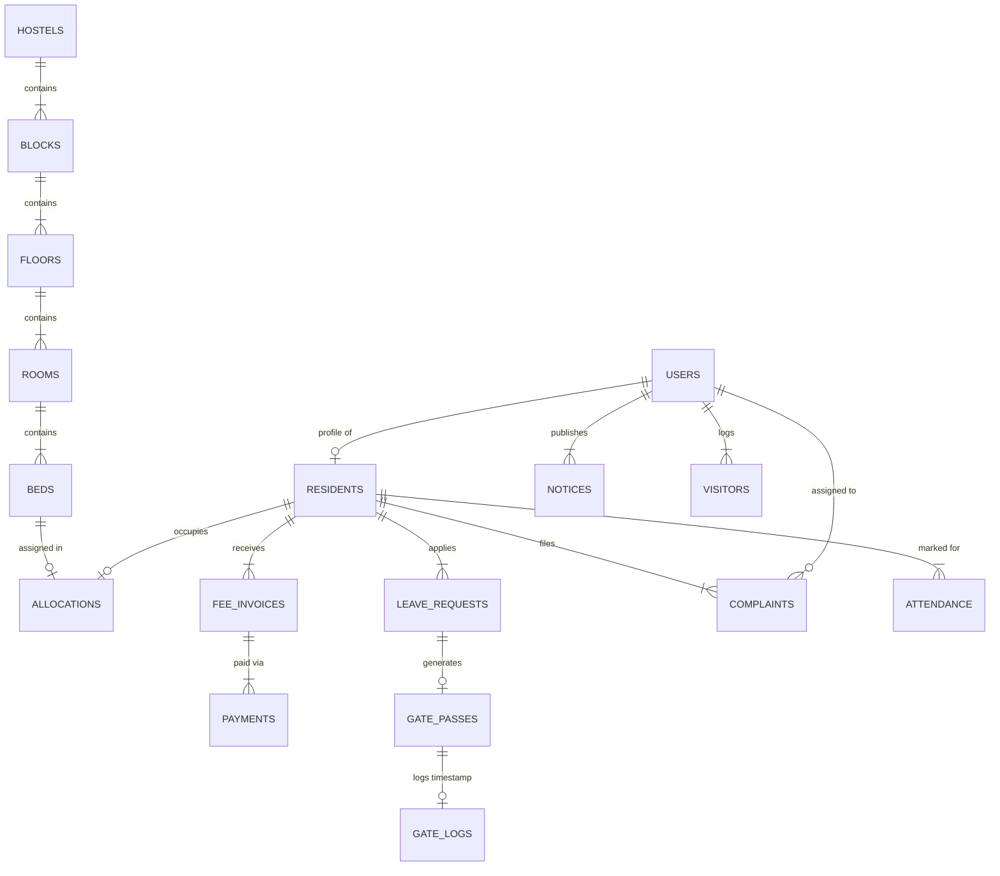

# Staynest (Hostel Management System) - Engineering & Architecture Plan

> **Project Team (as per IEEE SRS v1.0 Section 6):**  
> - **Priyansh Keshwani** — Backend & Project Manager  
> - **Samriddhi Shrivastava** — Frontend & UI/UX Designer  
> - **Soumya Rathore** — Database & QA Engineer  

## 1. Executive Summary
The **Staynest Hostel Management System (HMS)** is a full-stack, enterprise-grade accommodation platform engineered according to the project Software Requirements Specification (SRS v1.0), UML Class-Based Modeling Guide, FARM Component Diagram Architecture, and Environmental Deployment Topology.

The architecture strictly decouples a high-performance **FastAPI (Python 3.11+)** REST application from a modern, responsive **React 18 + TypeScript + Tailwind CSS** single-page web client.

---

## 2. Derived Module Breakdown

| Module | Core Purpose & Features | Primary Users |
| :--- | :--- | :--- |
| **Auth & Security** | JWT Access + Refresh token flow, bcrypt password hashing, session management, RBAC dependencies. | All Users |
| **Dashboard** | KPI stat cards (occupancy rate, pending dues, active leaves, open complaints), quick-action drawers, visual occupancy breakdown charts, recent gate logs. | Super Admin, Warden, Accountant, Student |
| **Hostel & Room Hierarchy** | Management of Hostels, Blocks, Floors, Rooms, and Beds. Bed capacity enforcement, room types (Single AC, Double Non-AC, Triple, etc.), amenities. | Super Admin, Warden |
| **Interactive Room Allocation** | Visual Bed Grid showing real-time bed states (Available, Occupied, Maintenance), direct student bed allocation, room transfer workflow, deallocation/vacating. | Warden, Super Admin |
| **Students & Residents** | Admission directory, student profile, enrollment number, contact info, guardian/emergency contact, document uploads, active/alumni status. | Warden, Student, Super Admin |
| **Fees & Invoicing** | Fee head configuration, semester/monthly invoice generation, partial payment processing, overpayment validation, PDF/printable receipts, dues calculation, defaulters ledger. | Accountant, Warden, Student |
| **Attendance & Night Roll-Call** | Daily block/floor attendance register, mark Present/Absent/Late, automated synchronization with approved leaves. | Warden, Security Staff |
| **Leave & Gate Pass Workflow** | Outpass & leave submission, multi-status approval workflow (Pending, Approved, Rejected), digital QR/Passcode gate pass issuance, security gate logging (exit/entry timestamps). | Student, Warden, Security |
| **Complaints & Maintenance** | Categorized ticket submission (Electrical, Plumbing, Furniture, Cleanliness, Wi-Fi), priority levels, staff assignment, resolution updates with technician notes. | Student, Warden, Maintenance Staff |
| **Visitor Gate Management** | Visitor check-in/out log, resident association, visit reason, contact details, ID proof verification. | Security Staff, Warden |
| **Notices & Announcements** | Notice bulletin board, audience targeting (All, Specific Hostel Block), pinned urgent notices. | Warden, Super Admin, Student |
| **Mess & Dining Management** | Weekly meal menu schedule (Breakfast, Lunch, Snacks, Dinner), meal preference opt-ins. | Warden, Student |
| **Reports & Data Export** | Real-time occupancy analytics, collection vs outstanding dues, defaulters list, CSV and printable PDF report exports. | Super Admin, Warden, Accountant |
| **System Settings** | Academic sessions, hostel facilities configuration, user account management, audit logs. | Super Admin |

---

## 3. User Roles & Permissions Matrix

| Permission / Action | Super Admin | Warden / Admin | Accountant | Security Staff | Maintenance | Student |
| :--- | :---: | :---: | :---: | :---: | :---: | :---: |
| System Configuration & User Management |  Full |  Read |  None |  None |  None |  None |
| Hostel / Block / Room Configuration |  Full |  Full |  Read |  None |  None |  Read (Room) |
| Student Admission & Profile Edit |  Full |  Full |  Read |  Read (Basic) |  None |  Self-Profile |
| Bed Allocation / Transfer / Vacate |  Full |  Full |  None |  None |  None |  View Own Bed |
| Fee Heads & Invoice Generation |  Full |  Full |  Full |  None |  None |  None |
| Record Payments & Issue Receipts |  Full |  Full |  Full |  None |  None |  Pay Own Dues |
| Approve / Reject Leave Requests |  Full |  Full |  None |  None |  None |  Submit Own |
| Verify Gate Pass & Log Gate Timestamps |  Full |  Full |  None |  Full |  None |  View Own Pass |
| Attendance Roll Call |  Full |  Full |  None |  Read/Write |  None |  View Own |
| Complaints Resolution & Assignment |  Full |  Full |  None |  None |  Update Status | Lodge Own |
| Visitor Log Management |  Full |  Full |  None |  Full |  None |  None |
| Post Announcements / Notices |  Full |  Full |  None |  None |  None |  Read Only |
| Export Audit & Financial Reports |  Full |  Full |  Full |  None |  None |  None |

---

## 4. Database Schema (ER Overview)



### Table Definitions & Key Attributes

1. **`users`**
   - `id`: UUID / Integer (Primary Key)
   - `email`: VARCHAR(255) (Unique, Indexed)
   - `username`: VARCHAR(100) (Unique, Indexed)
   - `hashed_password`: VARCHAR(255)
   - `full_name`: VARCHAR(150)
   - `phone`: VARCHAR(20)
   - `role`: ENUM (`SUPER_ADMIN`, `WARDEN`, `ACCOUNTANT`, `SECURITY`, `MAINTENANCE`, `STUDENT`)
   - `is_active`: BOOLEAN (Default True)
   - `created_at`, `updated_at`: TIMESTAMP

2. **`hostels` & `blocks` & `floors`**
   - `hostels`: `id`, `name`, `code`, `address`, `contact_number`, `created_at`
   - `blocks`: `id`, `hostel_id` (FK), `name`, `gender` (`MALE`, `FEMALE`, `COED`), `warden_id` (FK `users.id`)
   - `floors`: `id`, `block_id` (FK), `floor_number`, `floor_name`

3. **`rooms` & `beds`**
   - `rooms`: `id`, `floor_id` (FK), `room_number`, `room_type` (`SINGLE_AC`, `SINGLE_NON_AC`, `DOUBLE_AC`, `DOUBLE_NON_AC`, `TRIPLE`, `DORMITORY`), `capacity`, `monthly_rate`, `status` (`AVAILABLE`, `FULL`, `MAINTENANCE`), `amenities` (JSON: Wi-Fi, Balcony, Attached Bath, etc.)
   - `beds`: `id`, `room_id` (FK), `bed_number` (e.g. A, B, C), `status` (`AVAILABLE`, `OCCUPIED`, `MAINTENANCE`)

4. **`residents` (Student Profiles)**
   - `id`: UUID / Integer (Primary Key)
   - `user_id`: FK `users.id` (Unique)
   - `registration_number`: VARCHAR(50) (Unique, Indexed)
   - `course`: VARCHAR(100), `department`: VARCHAR(100), `year_of_study`: INT
   - `gender`: VARCHAR(20), `dob`: DATE, `blood_group`: VARCHAR(10)
   - `emergency_contact_name`: VARCHAR(100), `emergency_contact_phone`: VARCHAR(20), `guardian_relation`: VARCHAR(50)
   - `permanent_address`: TEXT
   - `avatar_url`: VARCHAR(255), `id_proof_url`: VARCHAR(255)
   - `status`: ENUM (`ACTIVE`, `TRANSFERRED`, `GRADUATED`, `SUSPENDED`)

5. **`allocations` (Bed Allocation Ledger)**
   - `id`: Primary Key
   - `resident_id`: FK `residents.id`
   - `bed_id`: FK `beds.id`
   - `academic_year`: VARCHAR(20) (e.g., "2026-2027")
   - `allocated_from`: DATE, `allocated_to`: DATE (Nullable)
   - `status`: ENUM (`ACTIVE`, `TRANSFERRED`, `VACATED`)
   - `remarks`: TEXT

6. **`fee_structures` & `fee_invoices` & `payments`**
   - `fee_structures`: `id`, `academic_year`, `room_type`, `title`, `amount`, `frequency` (`MONTHLY`, `SEMESTER`, `ANNUAL`)
   - `fee_invoices`: `id`, `invoice_number` (Unique), `resident_id` (FK), `title`, `billing_period`, `total_amount`, `paid_amount`, `due_date`, `status` (`UNPAID`, `PARTIALLY_PAID`, `PAID`, `OVERDUE`)
   - `payments`: `id`, `invoice_id` (FK), `resident_id` (FK), `receipt_number` (Unique), `amount`, `payment_method` (`CASH`, `UPI`, `CARD`, `NET_BANKING`, `DEMAND_DRAFT`), `transaction_ref`: VARCHAR(100), `status` (`SUCCESS`, `PENDING`, `FAILED`), `paid_at`: TIMESTAMP, `recorded_by_id`: FK `users.id`

7. **`leave_requests` & `gate_passes` & `gate_logs`**
   - `leave_requests`: `id`, `resident_id` (FK), `leave_type` (`OUTPASS`, `HOME_LEAVE`, `MEDICAL`, `EMERGENCY`), `start_time`: TIMESTAMP, `end_time`: TIMESTAMP, `destination`: TEXT, `reason`: TEXT, `parent_approval_status`: BOOLEAN, `status` (`PENDING`, `APPROVED`, `REJECTED`, `CANCELLED`), `reviewed_by_id`: FK `users.id`, `reviewer_remarks`: TEXT
   - `gate_passes`: `id`, `pass_number` (Unique, e.g. `GP-2026-0042`), `leave_request_id` (FK), `resident_id` (FK), `qr_token`: VARCHAR(255), `valid_from`: TIMESTAMP, `valid_until`: TIMESTAMP, `status` (`ISSUED`, `CHECKED_OUT`, `CHECKED_IN`, `EXPIRED`)
   - `gate_logs`: `id`, `gate_pass_id` (FK), `security_officer_id` (FK `users.id`), `action` (`EXIT`, `ENTRY`), `timestamp`: TIMESTAMP, `remarks`: TEXT

8. **`complaints`**
   - `id`: Primary Key, `ticket_number`: VARCHAR(50) (Unique)
   - `resident_id`: FK `residents.id`
   - `room_id`: FK `rooms.id` (Nullable)
   - `category`: ENUM (`ELECTRICAL`, `PLUMBING`, `FURNITURE`, `CLEANLINESS`, `INTERNET`, `OTHER`)
   - `title`: VARCHAR(200), `description`: TEXT
   - `priority`: ENUM (`LOW`, `MEDIUM`, `HIGH`, `EMERGENCY`)
   - `status`: ENUM (`OPEN`, `IN_PROGRESS`, `RESOLVED`, `CLOSED`)
   - `assigned_to_id`: FK `users.id` (Nullable)
   - `resolution_notes`: TEXT, `resolved_at`: TIMESTAMP

9. **`attendance`**
   - `id`: Primary Key, `resident_id`: FK `residents.id`, `date`: DATE, `status`: ENUM (`PRESENT`, `ABSENT`, `ON_LEAVE`, `LATE_ENTRY`), `marked_by_id`: FK `users.id`, `remarks`: VARCHAR(255)

10. **`visitors`**
    - `id`: Primary Key, `visitor_name`: VARCHAR(100), `phone`: VARCHAR(20), `resident_id`: FK `residents.id`, `relationship`: VARCHAR(50), `id_proof_type`: VARCHAR(50), `id_proof_number`: VARCHAR(50), `check_in_time`: TIMESTAMP, `check_out_time`: TIMESTAMP (Nullable), `purpose`: VARCHAR(255), `logged_by_id`: FK `users.id`

11. **`notices` & `mess_menus`**
    - `notices`: `id`, `title`, `content`, `target_role`, `is_pinned`: BOOLEAN, `author_id`: FK `users.id`, `created_at`: TIMESTAMP
    - `mess_menus`: `id`, `day_of_week` (`MONDAY`..`SUNDAY`), `breakfast`: TEXT, `lunch`: TEXT, `snacks`: TEXT, `dinner`: TEXT, `special_diet_note`: VARCHAR(255)

---

## 5. API Endpoint Architecture (FastAPI v1)

### Prefix: `/api/v1`

#### Auth & Account (`/auth`)
- `POST /auth/login` - Authenticate username/password, returns `{ access_token, refresh_token, user }`
- `POST /auth/refresh` - Refresh access token
- `POST /auth/logout` - Invalidate session
- `GET /auth/me` - Current authenticated user profile and permissions

#### Dashboard & Analytics (`/analytics`)
- `GET /analytics/dashboard-stats` - Occupancy counts, bed status, total dues, pending leaves, open complaints
- `GET /analytics/occupancy-chart` - Block-wise and room-type occupancy distribution
- `GET /analytics/financial-summary` - Monthly billing vs collections, defaulter count
- `GET /analytics/recent-activity` - Real-time stream of admissions, gate logs, complaints

#### Hostel & Room Structure (`/hostels`, `/blocks`, `/rooms`, `/beds`)
- `GET /hostels` - List hostels
- `POST /hostels` - Create hostel
- `GET /blocks` - List blocks (filter by hostel, gender)
- `POST /blocks` - Create block
- `GET /rooms` - Paginated rooms with filter by block, floor, type, status
- `POST /rooms` - Create room + auto-provision beds
- `GET /rooms/{id}` - Room details with bed status and occupant list
- `PATCH /rooms/{id}` - Update room details
- `GET /beds/grid` - Optimized visual grid matrix payload (Hostel/Block -> Floor -> Room -> Beds with occupant cards)

#### Room Allocations (`/allocations`)
- `POST /allocations` - Allocate student to bed (validates bed availability & capacity)
- `POST /allocations/transfer` - Transfer student to a new bed
- `POST /allocations/{id}/vacate` - Vacate bed, marks bed Available and allocation Vacated
- `GET /allocations/history` - Historical allocation records with search/filters

#### Residents / Students (`/students`)
- `GET /students` - Paginated resident list (search by name, reg_no, room, status)
- `POST /students` - Register new resident (+ creates user account)
- `GET /students/{id}` - Full resident profile (personal, guardian, room, invoices, gate passes)
- `PUT /students/{id}` - Update student profile
- `DELETE /students/{id}` - Archive/Deactivate resident

#### Fees & Invoicing (`/fees`)
- `GET /fees/structures` - List configured fee heads & templates
- `POST /fees/structures` - Create/update fee structure
- `GET /fees/invoices` - Paginated invoices (filter by status, student, period)
- `POST /fees/invoices/generate` - Bulk generate invoices for active residents
- `POST /fees/invoices/individual` - Create single custom invoice
- `GET /fees/invoices/{id}` - Invoice details with payment ledger
- `POST /fees/payments` - Record payment against invoice (validates against balance)
- `GET /fees/receipts/{receipt_no}` - Detailed receipt data for PDF generation
- `GET /fees/defaulters` - List residents with overdue balance

#### Attendance & Leaves (`/attendance`, `/leaves`, `/gate-passes`)
- `GET /attendance` - Attendance register for a given date and block
- `POST /attendance/mark-bulk` - Submit roll-call attendance entries
- `GET /leaves` - List leave applications (filter by status, resident)
- `POST /leaves` - Resident submits leave/outpass request
- `PATCH /leaves/{id}/review` - Warden approves/rejects with remarks (triggers Gate Pass)
- `GET /gate-passes/active` - Security view of active gate passes
- `GET /gate-passes/verify/{qr_token_or_code}` - Verify pass validity and resident details
- `POST /gate-passes/{id}/log` - Security officer logs Exit or Entry timestamp

#### Complaints (`/complaints`)
- `GET /complaints` - Paginated complaints (filter by category, priority, status)
- `POST /complaints` - File new complaint (Student or Warden)
- `PATCH /complaints/{id}/assign` - Assign to maintenance staff
- `PATCH /complaints/{id}/status` - Update ticket status and resolution notes

#### Visitors (`/visitors`)
- `GET /visitors` - Paginated visitor register
- `POST /visitors/check-in` - Record visitor arrival
- `PATCH /visitors/{id}/check-out` - Record departure timestamp

#### Notices & Mess (`/notices`, `/mess`)
- `GET /notices` - List active notices
- `POST /notices` - Create announcement
- `DELETE /notices/{id}` - Remove notice
- `GET /mess/menu` - Retrieve 7-day meal schedule
- `PUT /mess/menu` - Update mess meal items

#### Reports Export (`/reports`)
- `GET /reports/occupancy/export` - Export occupancy CSV/PDF
- `GET /reports/fees/export` - Export financial collections CSV/PDF
- `GET /reports/defaulters/export` - Export defaulters CSV/PDF

---

## 6. Frontend Route Map & Information Hierarchy

```
/ (Redirects to /dashboard or /login)
├── /login                         [Clean split-screen auth with role-switcher demo buttons]
├── /dashboard                     [Role-tailored: KPI Cards, Quick Actions, Occupancy/Fee charts, Recent Activities]
├── /rooms
│   ├── /rooms/grid                [Signature Visual Room/Bed Grid: Live Filter by Block, Floor, Availability]
│   ├── /rooms/list                [Dense data table of rooms with capacity, rates, amenities, action modals]
│   └── /rooms/:id                 [Room details: occupant profiles, bed slots, maintenance records]
├── /allocations                   [Active allocations, Allocation modal, Bed Transfer wizard, Vacate dialog]
├── /students
│   ├── /students/list             [Resident directory with search, filters, status pills, admission button]
│   ├── /students/admit            [Tabbed admission form: Personal, Guardian, Academic, Document Upload]
│   └── /students/:id              [Student 360 profile: Bed info, Invoices, Outpasses, Complaints, Timeline]
├── /fees
│   ├── /fees/invoices             [Invoice ledger, Generate batch invoices, Record payment modal]
│   ├── /fees/structure            [Fee head setup: Room rent, mess, caution, utility]
│   ├── /fees/defaulters           [Overdue tracker, balance summaries, export]
│   └── /fees/receipts/:id         [Printable / PDF preview receipt modal]
├── /attendance                    [Night roll-call grid per block/floor, auto-leave badges, quick one-click mark]
├── /leaves
│   ├── /leaves/list               [Leave requests table, Warden review actions, Status indicators]
│   ├── /leaves/apply              [Student leave/outpass request drawer/modal]
│   └── /leaves/gate-pass/:id      [Digital gate pass with QR code, barcode, student photo & verification status]
├── /gate-security                 [Security gate officer terminal: Quick pass look-up, In/Out timestamp logging, Visitor entry]
├── /complaints                    [Ticket board: filter by status (Open/In Progress/Resolved), Assignee, Category]
├── /mess                          [Weekly mess menu timetable, meal plans]
├── /notices                       [Announcements bulletin, pinned alerts, create notice modal]
├── /reports                       [Export center: Occupancy report, Revenue report, Defaulters list]
└── /settings                      [Hostel info, academic years, user account management]
```

---

## 7. Design System & UI Specification

### Neutral & Accent Tokens
- **Base Canvas**: Neutral cool-gray background (`#F8FAFC` - `slate-50`), Pure white cards (`#FFFFFF`).
- **Primary Brand Accent**: Restrained Deep Teal (`#0F766E` - `teal-700`, Hover `#115E59` - `teal-800`, Light tint `#F0FDFA` - `teal-50`), strictly matching the inspiration aesthetic without purple/indigo gradient cliches.
- **Borders & Dividers**: Subtle 1px borders (`#E2E8F0` - `slate-200`).
- **Typography**: Inter / system font, 14px base, crisp tracking, distinct weights (Medium 500, Semi-Bold 600, Bold 700).
- **Radius**: Consistent small border radius (`rounded-lg` / `6px - 8px`).
- **Status Badges (Pills)**:
  - `Available` / `Paid` / `Present` / `Approved`: Soft Emerald (`bg-emerald-50 text-emerald-700 border-emerald-200`)
  - `Occupied` / `In Progress` / `Partial`: Soft Sky/Blue (`bg-sky-50 text-sky-700 border-sky-200`)
  - `Pending` / `Late`: Soft Amber (`bg-amber-50 text-amber-700 border-amber-200`)
  - `Maintenance` / `Overdue` / `Absent` / `Rejected`: Soft Rose/Red (`bg-rose-50 text-rose-700 border-rose-200`)

---

## 8. Build Phases & Verification Checklist

- **Phase 1: Foundation Setup & DB Layer**
  - Initialize `/hostel-management` root, backend FastAPI app, and frontend Vite React app.
  - Setup SQLAlchemy 2.0 models, SQLite/PostgreSQL engine, Alembic migrations.
  - Implement JWT authentication, password hashing, and role-based access control dependencies.
  - Write complete seed script with realistic Indian student names, blocks (A-Block Boys, B-Block Girls), rooms, fees, sample leaves, and complaints.
  - *Verification*: Run seed script, verify SQLite tables populated, test `/docs` Swagger endpoint.

- **Phase 2: Core Backend Services, Repositories & APIs**
  - Implement layered routers: Auth, Hostels, Rooms, Allocations, Students, Fees, Attendance, Leaves & GatePasses, Complaints, Visitors, Notices, Reports.
  - Implement business rules: Bed capacity verification, double-booking prevention, overpayment check, leave approval gate-pass generation.
  - Write automated Pytest suite covering auth, room allocation capacity, and fee payment logic.
  - *Verification*: Execute `pytest` and verify all tests pass with 100% assertions green.

- **Phase 3: Frontend Foundation & Design Tokens**
  - Configure Tailwind CSS with custom teal accent tokens, Inter typography, and shadcn/Radix primitives.
  - Build reusable UI component library: `Button`, `Input`, `Select`, `Card`, `Badge`, `Modal`, `Drawer`, `DataTable`, `StatCard`, `EmptyState`, `Toast`.
  - Implement Axios client with JWT interceptor and automated token refresh.
  - Implement fixed left navigation sidebar, top header (search, notifications, user avatar, role switcher), and role-based route guard.
  - *Verification*: Test login screen, role switcher, sidebar navigation responsiveness.

- **Phase 4: Frontend Feature Modules & Visual Signature Screens**
  - **Dashboard**: Live stats, occupancy bar/pie charts, pending items, recent feed.
  - **Room Allocation Grid**: Signature visual interactive grid of beds (Available, Occupied, Maintenance), click-to-allocate and bed transfer.
  - **Student Directory & Admission**: Dense table with search/filters, full 360 student profile, admission modal.
  - **Fees & Financials**: Invoices ledger, partial payment recording modal, printable PDF receipt preview, defaulter report.
  - **Attendance & Outpass**: Night attendance roll-call grid with one-click toggles, Leave management with Warden approvals, Digital Gate Pass with QR.
  - **Complaints Desk**: Ticket queue with category badges, status update drawer, resolution notes.
  - **Gate Security Terminal**: Fast search/scan outpass validation, exit/entry logger, visitor check-in.
  - **Notices, Mess & Reports**: Weekly mess schedule, announcement board, CSV/PDF report download.
  - *Verification*: Test each module end-to-end against live backend APIs.

- **Phase 5: Polish, End-to-End Walkthrough & Documentation**
  - Verify error handling, empty states, and toast feedback across all forms.
  - Prepare `docker-compose.yml` for unified frontend + backend + postgres startup.
  - Produce comprehensive `README.md` with demo credentials for Super Admin, Warden, Accountant, Student, Security, and Maintenance.
